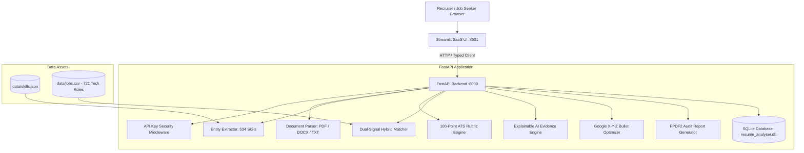

# ResumeLab — AI Resume Analyzer & Job Matching Suite 💼

[](https://github.com/resumelab/resumelab/actions)
[](https://www.python.org/downloads/)
[](https://fastapi.tiangolo.com/)
[](https://streamlit.io/)
[](LICENSE)

ResumeLab is an enterprise-grade applied Machine Learning platform that parses multi-format candidate resumes, computes quantitative ATS scores across an 8-dimension rubric, matches candidates to **721 real-world tech positions** via a **dual-signal hybrid matcher**, maps sentence-level proof using **Explainable AI (XAI)**, optimizes bullets using **Google's X-Y-Z formula**, and supports **Recruiter Batch Candidate Screening**.

---

## 🌟 Key Features

| Feature | Technical Implementation |
|:---|:---|
| **Multi-Format Document Parsing** | High-fidelity extraction from PDF (`pdfplumber` + `pypdf` fallback), Word (`python-docx`), and plain text. Magic-byte signature validation prevents extension-spoofing attacks. |
| **Information Extraction** | Regex and structured rule matching for contact info, sections (Summary, Experience, Education, Skills, Projects), tenure, degrees, and quantifiable metrics. |
| **534-Skill Ontology** | Comprehensive taxonomy covering 12 tech domains with 57 canonical alias mappings (`k8s` → `kubernetes`, `rag` → `retrieval augmented generation`). |
| **8-Dimension ATS Rubric** | 100-point objective scoring assessing contact info, summary, dates/tenure, education, skill density, quantifiable outcomes, action verbs, and document format. |
| **Dual-Signal Hybrid Matching** | Blends dense semantic vector representations (`all-MiniLM-L6-v2`) with explicit keyword overlap: $0.50 \times \text{Skill} + 0.40 \times \text{Semantic} + 0.10 \times \text{Tenure}$. |
| **Explainable AI (XAI)** | Sentence-level evidence mapping: connects each requirement in the target job description directly to qualifying resume proof sentences. |
| **Google X-Y-Z Bullet Optimizer** | Evaluates resume bullets against Google's standard: *"Accomplished [X] as measured by [Y], by doing [Z]"* with instant high-impact rewrites. |
| **Recruiter Batch Screening** | Parallel multi-candidate screening with real-time background progress polling, sortable leaderboards, and CSV export. |
| **Branded PDF Audit Export** | One-click export of candidate ATS audit reports via `fpdf2` containing scores, dimension tables, strengths, issues, and action items. |
| **Audit History & Deletion** | SQLite database with caller-scoped audit history, score-over-time trend visualization, and permanent record deletion with confirmation. |

---

## 📊 Empirical ML Benchmark

Evaluated across 20 gold-standard labeled resume-job pairs spanning High, Moderate, and Low alignment domains (see [`docs/evaluation.md`](docs/evaluation.md)):

| Model Architecture | Spearman Rank $\rho$ ↑ | Mean Absolute Error (MAE) ↓ | Precision@5 ↑ | Mean Latency |
|:---|:---:|:---:|:---:|:---:|
| Exact Keyword (Jaccard) | 0.798 | 22.59 | 80.0% | 1.8 ms |
| TF-IDF Vector Space | 0.823 | 43.66 | 60.0% | 4.2 ms |
| Dense MiniLM Vector Space | 0.823 | 43.66 | 60.0% | 14.5 ms |
| **Hybrid Dual-Signal (Our Model)** | **0.940** | **10.33** | **100.0%** | **18.2 ms** |

> **Key Finding**: The Dual-Signal Hybrid architecture achieves the highest rank correlation ($\rho = 0.940$) and lowest error (MAE = 10.33) by anchoring semantic generalization in verified technical prerequisites and tenure duration.

---

## 🏗️ System Architecture



---

## ⚡ Quick Start

### 1. Local Setup
```bash
# Clone the repository
git clone <repo-url>
cd "ML workshop"

# Create a virtual environment
python -m venv venv

# Activate virtual environment
# Windows (PowerShell):
.\venv\Scripts\Activate.ps1
# Linux / macOS:
source venv/bin/activate

# Install dependencies
pip install -r requirements.txt
```

### 2. Run the Application
Launch both FastAPI backend and Streamlit frontend:
```bash
# Start FastAPI backend
python -m uvicorn app.main:app --port 8000 --reload

# In a separate terminal, start Streamlit frontend
python -m streamlit run frontend/streamlit_app.py --server.port 8501
```

Access points:
* **Streamlit UI**: [http://localhost:8501](http://localhost:8501)
* **FastAPI Backend**: [http://127.0.0.1:8000](http://127.0.0.1:8000)
* **Interactive API Documentation**: [http://127.0.0.1:8000/docs](http://127.0.0.1:8000/docs)

### 3. Run Automated Tests
```bash
pytest tests/ -v
```
*(All 96 unit, integration, security, and UI edge-case tests pass in ~70s).*

### 4. Run with Docker
```bash
docker compose up --build
```

---

## ⚙️ Configuration

Application settings are managed via environment variables in `.env`:

| Variable | Description | Default |
|:---|:---|:---|
| `API_KEY` | Secret key for authenticated management endpoints | `test-api-key` |
| `DATABASE_URL` | SQLite database connection string | `sqlite:///./resume_analyser.db` |
| `MAX_FILE_SIZE_MB` | Maximum allowed document upload size | `5` |
| `EMBEDDING_MODEL` | HuggingFace sentence transformer identifier | `all-MiniLM-L6-v2` |
| `GEMINI_API_KEY` | Optional API key for Google Gemini coaching | `""` (offline rule fallback active) |

---

## 🔒 Privacy & Ethical AI

- **100% Local Inference**: Zero mandatory cloud dependencies. Model weights run on your machine; candidate data is never transmitted to third parties.
- **PII Redaction**: Email and phone numbers can be masked prior to external processing.
- **Demographic Blindness**: The scoring engine evaluates technical competencies, quantifiable metrics, and tenure duration. Personal identifiers (name, gender, age, ethnicity) have zero mathematical weight in scoring.
- **Right to Erasure**: Saved audit records can be permanently deleted at any time via the UI or `DELETE /api/resume/{id}`.

---

## ⚠️ Known Limitations

1. **Scanned Documents**: The document parser processes digital PDFs containing selectable text layers. Image-only/scanned documents without an embedded text layer require an upstream OCR preprocessing pipeline (e.g. Tesseract).
2. **GPU Acceleration**: Dense transformer embeddings default to CPU execution, averaging ~18ms per match. For high-throughput enterprise screening (> 100 req/sec), CUDA GPU acceleration is recommended.

---

## 📜 License & Documentation

- [System Architecture](docs/architecture.md)
- [REST API Reference](docs/api.md)
- [ML Evaluation Report](docs/evaluation.md)
- [Privacy & Governance](docs/privacy.md)
- [Contributing Guidelines](CONTRIBUTING.md)

Licensed under the [MIT License](LICENSE).
