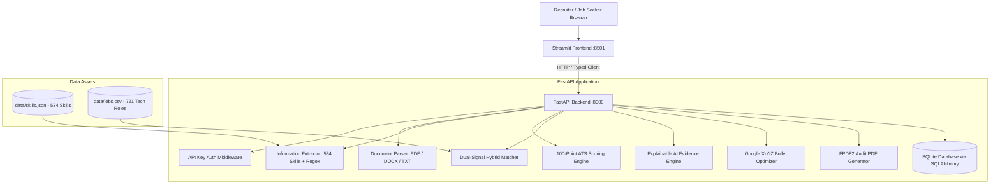

# ResumeLab System Architecture

## 1. High-Level Overview

ResumeLab is an enterprise-grade AI Resume Analyzer & Job Matching platform designed with a clean decoupled client-server architecture:
- **Backend Service**: FastAPI REST API running on port `8000`. Encapsulates all document parsing, entity extraction, 8-dimension quantitative ATS scoring, dual-signal ML matching, Explainable AI (XAI) sentence mapping, and SQLite audit database persistence.
- **Frontend Client**: Streamlit SaaS application running on port `8501`. Modularized into reusable UI components (`frontend/components/`), distinct workflow pages (`frontend/pages/`), and design tokens (`frontend/styles.css`). Consumes the backend strictly via the typed `ResumeLabClient`.

---

## 2. Component Breakdown

### A. Document Parsing Subsystem (`app/services/parser.py`)
- **Magic-Byte Signature Verification**: Prevents extension-spoofing attacks (validates `%PDF-`, `PK\x03\x04` for OpenXML DOCX, and rejects binary executables `MZ`, `\x7fELF` or NUL bytes in plain text).
- **Multi-Engine Strategy**: Uses `pdfplumber` for layout-accurate text extraction, with automatic fallback to `pypdf`. Handles DOCX via `python-docx` and multi-encoding plain text (`utf-8`, `utf-8-sig`, `latin-1`, `cp1252`).
- **Filename Sanitization**: Generates internal UUIDs and strips directory traversal patterns (`..`, `/`, `\`) and non-whitelisted characters.

### B. Entity & Skill Extraction Subsystem (`app/services/extractor.py`)
- **Normalized Skill Ontology**: 534 technical and soft skills across 12 domains (Programming, Web, Data, ML/AI, Cloud/DevOps, Mobile, Security, QA, etc.).
- **Synonym Resolution**: 57 canonical alias mappings (e.g., `k8s` → `kubernetes`, `tf` → `tensorflow`, `postgres` → `postgresql`).
- **Standard Section Parser**: Detects and isolates Summary, Experience, Education, Skills, and Projects sections.
- **Tenure & Metrics Calculator**: Extracts chronological employment periods, calculating total years of experience and quantifiable metrics (percentages, Rupee (₹) amounts, KPIs).

### C. 100-Point ATS Scoring Rubric (`app/services/scorer.py`)
Evaluates 8 quantitative dimensions:
1. **Contact Information (10 pts)**: Verified email format, telephone digits, and candidate name.
2. **Professional Summary (10 pts)**: Presence of executive overview or objective.
3. **Work Experience with Dates (15 pts)**: Standard job titles with verified start/end dates.
4. **Education Credentials (10 pts)**: Degree designation, institution name, graduation year.
5. **Technical & Domain Skills (20 pts)**: Density and breadth of relevant competencies.
6. **Quantifiable Accomplishments (15 pts)**: Metrics, numbers, Rupee (₹) amounts, and KPIs.
7. **Action Verb Density (10 pts)**: Strong initial action verbs (*spearheaded, architected*).
8. **ATS Formatting & Length (10 pts)**: Clean section headers and 1–2 page length.

### D. Dual-Signal Hybrid Matcher (`app/services/matcher.py`)
Blends dense semantic vector representations with explicit keyword verification:
$$\text{Match Score} = 0.50 \times \text{Skill Overlap} + 0.40 \times \text{Semantic Vector Similarity} + 0.10 \times \text{Tenure Alignment}$$
- **Dense Embedding**: `sentence-transformers/all-MiniLM-L6-v2` generating 384-dimensional cosine similarities, with automatic TF-IDF fallback when offline.
- **Skill Overlap**: Jaccard similarity across normalized target requisition skills and candidate competencies.
- **Tenure Alignment**: Ratio between candidate experience years and job requirements, capped at $1.0$.

### E. Explainable AI (XAI) Evidence Mapper (`app/services/xai_explainer.py`)
- Splits target job descriptions into individual requirement clauses.
- Computes cosine similarity between each requirement and candidate resume sentences.
- Produces paired evidence cards showing exact resume proof alongside requisition requirements.

### F. Google X-Y-Z Bullet Optimizer (`app/services/bullet_optimizer.py`)
- Evaluates bullets against Google's formula: *"Accomplished [X] as measured by [Y], by doing [Z]"*.
- Assesses action verb presence, quantifiable metric presence, and technical context/scope.
- Provides immediate high-impact rewrites adhering to executive recruitment standards.

### G. Audit Database & Security (`app/database.py`, `app/models.py`)
- **ORM Engine**: SQLAlchemy with SQLite database (`resume_analyser.db`).
- **Caller Isolation**: History records are scoped by client identifier.
- **API Authentication**: Enforced via `X-API-Key` header validation on sensitive management routes.
- **Compliance Deletion**: Explicit DELETE endpoints for permanent record eradication.

---

## 3. Frontend Architecture (`frontend/`)

- **Design System (`styles.css`)**: Defined using CSS variables (`--color-primary: #2563eb`, `--color-text: #0f172a`, `--font-base: 16px`), 8-px spacing grid, system font stack, and WCAG AA compliant contrast.
- **Component Primitives (`components/`)**:
  - `score_ring.py`: Accessible SVG score ring with text descriptors.
  - `skill_chips.py`: Escaped matched (`✓`), missing (`✗`), and bonus (`★`) badges.
  - `evidence_card.py`: Requirement vs candidate proof comparison.
  - `stat_card.py`: Metric cards with one-line explanations.
  - `charts.py`: Plotly category bars, skill radar, and match signal charts.
  - `empty_state.py`: Actionable placeholders for empty states.
  - `error_banner.py`: Accessible error alerts with recovery steps.
- **Workflow Pages (`pages/`)**:
  - `1_home.py`: Upload area with 4-step pipeline strip and 3 demo candidate files.
  - `2_results.py`: Candidate summary card with "Replace resume" action, 4-card metric row, "Fix first" card, distinct cards for Strengths, Skills, and Sections, and popover rubric explanations.
  - `3_job_match.py`: 2-column layout with dual-signal gauge, skill overlap chips, evidence mapping, and "Improve for this job" pre-fill button.
  - `4_job_recommendations.py`: Top-N recommended positions with filters and "Why this job" expanders.
  - `5_batch_and_history.py`: Recruiter multi-resume screening with async progress bar, CSV leaderboard export, score trend charts, and record deletion.
